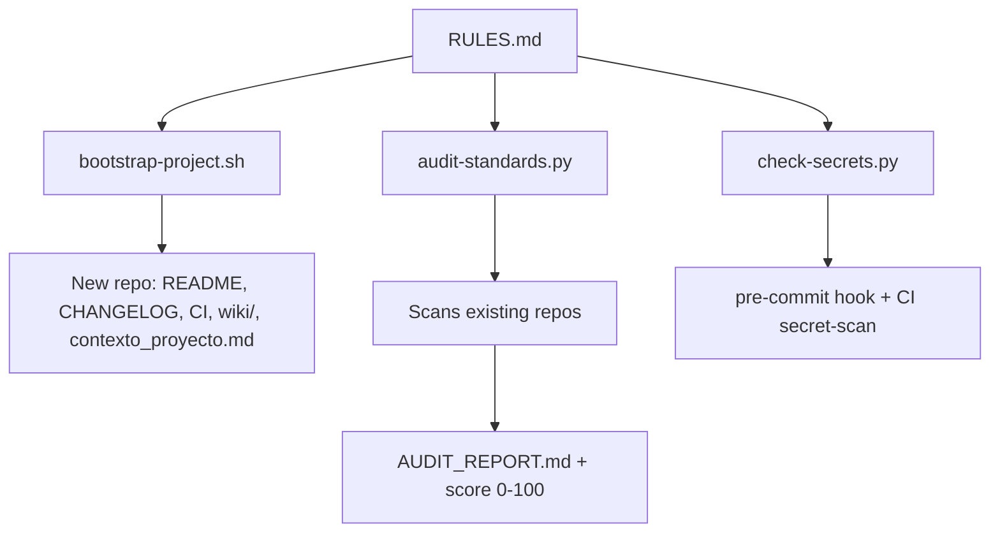

# dev-standards

Engineering standards, scaffolding and automated auditing for the luciomerlo project ecosystem.


## Architecture



## What this repo contains

| File / folder | Role |
|---|---|
| [`AGENTS.md`](AGENTS.md) | Agent instructions, the **canonical list of external standards** (`apple-design-skill` §8, Graft §9, `claude-code-best-practice` §11, `/fix` §3.4) and public knowledge bases (§10) |
| [`RULES.md`](RULES.md) | Mandatory directives: architecture, resilience, versioning, LLM context (§5.10), secret safety (§6), local vs. web compute (§7), dashboard aesthetics with Apple HIG (§8), Graft context graph (§9), public knowledge bases (§10), Claude Code configuration (§11) |
| [`contexto_proyecto.md`](contexto_proyecto.md) | Consolidated codebase for a downstream LLM (§5.10). Regenerate with `scripts/generate-contexto.py` |
| [`docs/code-standards.md`](docs/code-standards.md) | Naming, formatting, testing, review checklist |
| [`docs/commit-conventions.md`](docs/commit-conventions.md) | Commit conventions |
| `scripts/bootstrap-project.sh` | Generates the full scaffolding in a new repo (README, CHANGELOG, CI, `.gitignore`, Dockerfile, `wiki/`, secret guardrail) |
| `scripts/audit-standards.py` | Audits existing repos against RULES.md and produces `AUDIT_REPORT.md` with a 0-100 score |
| `scripts/find-public-api.py` | Searches the pinned `public-apis` catalog by category, text, auth, HTTPS and CORS (RULES.md §10.2) |
| `scripts/generate-contexto.py` | Regenerates `contexto_proyecto.md` (RULES.md §5.10) |
| `scripts/check-secrets.py` | Blocks commits/CI with hardcoded credentials (RULES.md §6) |
| `scripts/gpu_compute.py` | CUDA detection + compute backend selection (RULES.md §7) |
| `scripts/make_colab_notebook.py` | Generates the companion notebook for the `colab` backend |
| `scripts/run_on_runpod.py` | Client for the `cloud-serverless` backend (RunPod) |
| `scripts/run_on_modal.py` | Client for the `modal` backend ([Modal](https://modal.com), ~$30 USD/month free) |
| `scripts/transcribe_via_groq.py` | Client for the `cloud-api` backend for Whisper-based projects (Groq) |
| `scripts/run_on_hf_inference.py` | Client for the `cloud-api` backend for other models hosted on HF |
| `.claude/skills/apple-design` | Pinned submodule of [`apple-design-skill`](https://github.com/dickwu/apple-design-skill), the dashboard standard (§8). Clone with `--recurse-submodules` |
| `knowledge/standards/claude-code-best-practice` | Pinned submodule of [`shanraisshan/claude-code-best-practice`](https://github.com/shanraisshan/claude-code-best-practice), the Claude Code configuration standard (§11). Shallow, ~77 MB |
| `knowledge/public/public-apis` | Pinned submodule of [`public-apis/public-apis`](https://github.com/public-apis/public-apis), catalog of public HTTP APIs (§10). Clone with `--recurse-submodules` |
| [`wiki/`](wiki/Home.md) | Operational wiki for this repo itself (onboarding, architecture, runbook) |

## Quick usage

Scaffolding a new repo:

```bash
bash scripts/bootstrap-project.sh --lang python --name "MyProject" --desc "Short description"
```

Audit every project under a directory:

```bash
python scripts/audit-standards.py --root /path/to/Projects --fail-on-regression
```

Regenerate the consolidated LLM context after changing code, configuration or documentation:

```bash
python scripts/generate-contexto.py
```

Scan for hardcoded secrets (used by the pre-commit hook and CI):

```bash
python scripts/check-secrets.py --tree      # versioned tree
python scripts/check-secrets.py --history   # full history
```

## Configuration

Copy `.env.example` to `.env` if you are going to run the scripts with credentials (e.g. GitHub tokens to automate scaffolding).

## Standards applied (visual checklist)

| Standard (RULES.md) | Status |
|---|---|
| SemVer in the manifest (`pyproject.toml`) | ✅ |
| CHANGELOG (Keep a Changelog) | ✅ |
| `.gitignore` | ✅ |
| Dockerfile | ✅ |
| CI/CD GitHub Actions | ✅ |
| `.env.example` | ✅ |
| Wiki (`wiki/`, §5.9) | ✅ |
| LLM context (`contexto_proyecto.md`, §5.10) | ✅ |
| Secret scanning (§6) | ✅ |
| Public knowledge base (`public-apis`, §10) | ✅ |

## Documentation

- [Wiki](wiki/Home.md) — onboarding, architecture and runbook
- [contexto_proyecto.md](contexto_proyecto.md) — consolidated codebase for an LLM (RULES.md §5.10)
- [RULES.md](RULES.md) — architecture, resilience, versioning and security standards
- [Code standards](docs/code-standards.md)
- [Commit conventions](docs/commit-conventions.md)

## License

MIT — see `LICENSE`.
